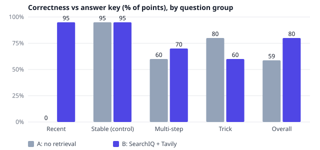
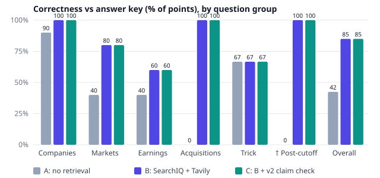

# SearchIQ baseline eval

**Headline:** Retrieval is what makes SearchIQ useful for anything recent. On recent events it lifts correctness from 0% to 95%, and on post-cutoff business facts from 0% to 100%. It does nothing for stable facts (95% → 95%, the control), and it made trick questions worse: 80% → 60% handled correctly, because search results drew the model into accepting false premises.

**Arm C (the v2 claim check)** leaves correctness unchanged: 80% core and 85% business, the same as B. That's by design, because it doesn't rewrite the answer. What it does is flag the risky answers. Across both sets it marked 8 of the 12 answers B got wrong (confidence below High or a premise warning), and it raised a premise warning on 9 of 10 core trick questions. The cost: it also flagged 9 of 48 answers B got right, and the judge didn't give credit for the warnings (trick correctness stays 60%). See [Arm C](#arm-c-searchiq-v2-claim-check).

**Arm D (the check rewrites flagged answers, live now)** fixes most of the trick failures: core trick correctness goes 60% → 90%, and core overall 80% → 87.5%. But it costs one business answer, so business drops 85% → 80%: on K5 a correct "a future price can't be known" was rewritten into speculative 2035 price forecasts. **Calibration:** answers labelled HIGH were right 43 of 49 times in D (39 of 43 in C). LOW is not a reliable "wrong" signal, and MEDIUM was never assigned. See [Arm D](#arm-d-the-check-rewrites-flagged-answers) and [Calibration](#calibration-are-the-confidence-labels-honest).

A and B are the **baseline**: SearchIQ v2 wording, before any agent features. Arm C adds the v2 claim check ([arm_c.md](arm_c.md), locked in `e8736d8` before it ran).

## Method

| | |
|---|---|
| Question sets | **Core:** 40 questions in 4 groups of 10: recent events, stable facts (control), multi-step, trick/unanswerable ([questions.jsonl](questions.jsonl)). **Business:** 20 analyst-style questions on companies, markets, earnings and acquisitions, plus 3 trick and 5 † post-cutoff questions that overlap those groups ([business_questions.jsonl](business_questions.jsonl)). Every answer key cites exact source URLs. |
| Locked first | The questions, answer keys, rubric and prompts were committed before any answer was generated: `b4f6182` (core, 19:39 PT) and `dac4e28` / `e82021f` (business, 19:57–19:58 PT). The first answer ran at 20:13 PT on 2026-11-09. A SHA-256 fingerprint check confirms the prompts were not changed. |
| Arm A | No retrieval. Same model and the same SearchIQ system prompt, with the grounding paragraph swapped out. |
| Arm B | SearchIQ: one Tavily basic search (3 results), then the live app's grounded prompt with numbered citations. |
| Answer model | `openai/gpt-oss-20b`, reasoning effort low, **temperature 0**. The live app uses 0.4, so live answers vary more than these. |
| Judge | `openai/gpt-oss-120b`, reasoning effort medium, temperature 0. It sees the question, answer key, grading notes, the answer and (for B) the search results, and returns correctness 0/1/2, groundedness 0/1/2, declined true/false and a rationale ([rubric.md](rubric.md), [business_rubric.md](business_rubric.md)). Business questions are graded on **required** elements only. |
| Provider | Groq for every call. Most calls hit Groq directly. The last 26 core verdicts, the last 8 business answers and all 40 business verdicts went through OpenRouter **pinned to Groq with fallbacks off**: the same model on the same host. The runner stops if any other provider serves a call. |
| Raw data | Everything is saved in [results/](results/) and [results_business/](results_business/): answers, cached search results, verdicts with rationales, token budgets and run logs. |

Correctness % = the sum of scores ÷ (2 × n). "Fully correct" = the number of answers scoring 2. Latency is the median wall time per answer, including the Tavily search for B.

## Results: core set (40 questions)

| Group | Arm | Correct | Fully correct | Grounded | Declined | Median latency | Cost / answer |
|---|---|---|---|---|---|---|---|
| Recent events | A | 0% | 0/10 | 50% | 9/10 (unneeded) | 0.37s | $0.00004 |
| | **B** | **95%** | **9/10** | **100%** | 0/10 | 2.23s | $0.00011 |
| Stable facts (control) | A | 95% | 9/10 | 95% | 0/10 | 0.29s | $0.00003 |
| | B | 95% | 9/10 | 95% | 0/10 | 2.21s | $0.00010 |
| Multi-step | A | 60% | 6/10 | 90% | 3/10 (unneeded) | 0.33s | $0.00004 |
| | B | 70% | 7/10 | 80% | 3/10 (unneeded) | 2.23s | $0.00011 |
| Trick / unanswerable | **A** | **80%** | **8/10** | 75% | 3/10 | 0.34s | $0.00004 |
| | B | 60% | 6/10 | 80% | 3/10 | 1.92s | $0.00011 |
| **Overall** | A | 58.8% | 23/40 | 77.5% | 12/30 unneeded | 0.33s | $0.00004 |
| | **B** | **80.0%** | **31/40** | **88.8%** | 3/30 unneeded | 2.16s | $0.00011 |



## Results: business set (20 questions)

| Group | Arm | Correct | Fully correct | Grounded | Median latency |
|---|---|---|---|---|---|
| Companies (5) | A | 90% | 4/5 | 90% | 0.27s |
| | B | 100% | 5/5 | 100% | 1.89s |
| Markets (5) | A | 40% | 2/5 | 40% | 0.29s |
| | B | 80% | 4/5 | 90% | 2.47s |
| Earnings (5) | A | 40% | 2/5 | 40% | 0.34s |
| | B | 60% | 3/5 | 80% | 7.92s |
| Acquisitions (5) | A | 0% | 0/5 | 0% | 0.53s |
| | B | 100% | 5/5 | 90% | 2.72s |
| Trick (K5, E5, A5) | A | 67% | 2/3 | 67% | 0.38s |
| | B | 67% | 2/3 | 83% | 2.30s |
| † Post-cutoff (E1, E2, A2, A3, A4) | A | 0% | 0/5 | 0% | 0.41s |
| | **B** | **100%** | **5/5** | **90%** | 2.72s |
| **Overall** | A | 42.5% | 8/20 | 42.5% | 0.32s |
| | **B** | **85.0%** | **17/20** | **90.0%** | 2.47s |



## Per-group headlines

- **Recent events:** without search, the model either refused (9/10) or was wrong. With search, it got 9/10 fully right.
- **Stable facts (control):** no difference (95% vs 95%). Search costs about 3.5× more and is about 1.9s slower here, for no gain.
- **Multi-step:** a small gain (60% → 70%). B fixed some questions and broke others (M3 and M9 went from 2 to 0), so this is noise-sized at n = 10.
- **Trick questions: retrieval hurt.** B handled 6/10 vs A's 8/10. On T1 (the winner of a tournament that hasn't happened) and T2 (Einstein's "second" Nobel), B accepted the false premise, apparently because the search results looked related. Neither arm reliably declines: by the locked "declined = pass" metric, both score 3/10.
- **Business: companies/markets/earnings:** B is better or equal everywhere. Earnings is weakest (60%), and one slow search pushed its median latency to 7.9s.
- **Business: acquisitions and † post-cutoff:** A scored 0% on both. It had no knowledge of deals after its training cutoff, and still answered instead of saying so. B got 5/5 on each.
- **Business trick (n = 3):** tied at 2/3. B fixed A5 (a deal that never closed) but fell for E5 (a "fifth fiscal quarter").

## Arm C: SearchIQ v2 claim check

Arm C is B's answer, unchanged, plus the check note a v2 user sees under it (confidence, per-claim labels, premise warning). It's graded by the same locked judge. The check runs `agent.check_answers()` as deployed, with GPT-OSS 20B at temperature 0. The disagreement view isn't evaluated, because eval arm A has no retrieval, unlike the live app's A.

| Set | Arm | Correct | Fully correct | Grounded | Median latency |
|---|---|---|---|---|---|
| Core (40) | B | 80.0% | 31/40 | 88.8% | 2.16s |
| | C | 80.0% | 31/40 | 82.5% | 2.94s |
| Core trick (10) | B | 60% | 6/10 | 80% | 1.92s |
| | C | 60% | 6/10 | 60% | 2.59s |
| Business (20) | B | 85.0% | 17/20 | 90.0% | 2.47s |
| | C | 85.0% | 17/20 | 92.5% | 3.28s |

Every other group matches B on correctness. Groundedness moved on 7 answers, both ways (M6, T3, T5, T10 down; A4, K5 up; E5 down), even though B's text is identical. That's roughly the size of judge noise from a longer input. On T10 the judge noted the premise warning and still scored 0, because the answer text itself names a 51st state.

**Checker diagnostics** (exploratory, not in the locked rubric; "flagged" = confidence below High, or a premise warning):

| | Core | Business | Both |
|---|---|---|---|
| Wrong B answers it flagged (catch rate) | 6/9 | 2/3 | **8/12** |
| Right B answers it flagged anyway (false alarms) | 7/31 | 2/17 | **9/48** |
| Premise warning on trick questions | 9/10 | 1/3 | 10/13 |
| Premise warning on other questions | 0/30 | 1/17 | 1/47 |

**Per-group read:**
- **Trick:** the check spots false premises well (9 of 10 core trick questions), but it doesn't fix the answer. A user who reads the warning is protected; the text below it still accepts the premise. The next step is to have the warning rewrite or withhold the answer, then re-run this arm.
- **What it misses:** 4 of the 12 wrong answers were labelled High confidence. Two were incomplete rather than false (R3 omits the performer; M9 omits the founding year), and a claim check can't see a missing element. In S9 a wrong side detail wasn't extracted as a claim. In E4 the answer gave Tesla's 2023 production figure as deliveries, and the check accepted it because the number does appear in a source.
- **Cost:** about +0.8s and ~1.8K tokens per answer on GPT-OSS 20B.

## Arm D: the check rewrites flagged answers

Defined in [arm_d.md](arm_d.md), locked in `d86c89c` before it ran. When C's check flags a false premise or a contradicted claim, the answer is rewritten (correct the premise, remove or correct contradicted claims, add nothing new) and re-checked. Unflagged answers are identical to C and inherit C's verdict. 12 of 60 answers were rewritten: 9 of the 10 core trick questions (all but T8), plus K2, K5 and A5 from the business set.

| Set | Arm | Correct | Fully correct | Grounded | Median latency |
|---|---|---|---|---|---|
| Core (40) | B | 80.0% | 31/40 | 88.8% | 2.16s |
| | C | 80.0% | 31/40 | 82.5% | 2.94s |
| | **D** | **87.5%** | **34/40** | 85.0% | 3.34s |
| Core trick (10) | B / C | 60% | 6/10 | 80% / 60% | |
| | **D** | **90%** | **9/10** | 70% | 4.19s |
| Business (20) | B / C | 85.0% | 17/20 | 90.0% / 92.5% | |
| | D | 80.0% | 16/20 | 92.5% | 3.38s |
| Business trick (3) | B / C | 67% | 2/3 | 83% | |
| | D | 33% | 1/3 | 83% | 4.83s |

All other groups are unchanged from C.

What the rewrites did:
- **Fixed (3):** T1 (2030 World Cup winner → "it hasn't been played"), T2 (Einstein's "second" Nobel), T10 (the "51st state").
- **Still wrong (2):** T3, where the check wrongly believed Super Bowl LIX hadn't happened, and the rewrite repeated that. K2 was wrong before and after: it lacks the required shipment figure.
- **Broke (1):** K5. The check marked "no source gives a 2035 closing price" as *contradicted*, because the sources contained price forecasts. The rewrite then presented $619–$20,000 forecasts instead of declining. The failure mode is **forecasts treated as facts**.
- **Harmless (6):** T4–T7, T9 and A5 were already right and stayed right.

Cost: rewritten answers take ~1.3s more and two extra GPT-OSS 20B calls (rewrite + re-check). Unflagged answers cost nothing extra.

**Known issue (open):** the K5 failure, forecasts treated as facts, is listed on the Track Record page. It will be fixed in a separately locked arm E; arm D's results stay as they are.

## Calibration: are the confidence labels honest?

For each label shown on an answer: how many the judge scored fully right (correctness 2). Both sets combined; per-set tables are on the Track Record page and in `results*/calibration.json`.

| Label | Arm C | Arm D |
|---|---|---|
| HIGH | right 39 of 43 (91%) | right 43 of 49 (88%) |
| MEDIUM | none assigned | none assigned |
| LOW | right 8 of 13 (62%) | right 5 of 5 (100%) |
| No checkable claims | right 1 of 4 | right 2 of 6 |

- **HIGH is meaningful.** About 9 in 10 HIGH answers were right. Its 6 misses in D split evenly. Three are incomplete answers missing a required detail (R3, M9, K2), which a claim check can't see. Three are wrong facts that looked backed: S9 (a wrong side detail), K5 (forecasts presented as an answer) and E4 (Tesla's 2023 production figure given as deliveries).
- **LOW is not "probably wrong".** In C it drops to 62% right, so it carries some signal. In D, every LOW answer was right: these were corrected trick answers whose true claims ("no human has walked on Mars") simply aren't stated in the search results. LOW means "not confirmed by the sources", and the UI says so.
- **MEDIUM never fires.** Answers have few claims (usually 1–4), so the 50–80% band is rarely hit. Either the thresholds should change or the label set should be two-level. That's a change for the next locked arm, not a retroactive tweak.

## Judge agreement

**Pending your hand scores.** [results/human_scores.csv](results/human_scores.csv) holds 10 answers drawn with `random.Random(42)`, without the judge's scores. Fill in the three `your_*` columns, then run `python eval/searchiq_eval.py agree`. Until then, the judge's scores are unverified.

## Spend

| | Tokens (20b answers) | Tokens (120b judge) | List-price cost | Tavily credits |
|---|---|---|---|---|
| Core | 61,336 | 131,684 | $0.035 | 40 |
| Business | 31,225 | 68,957 | $0.019 | 20 |

The OpenRouter-routed part (74 calls) cost about $0.02 of prepaid credit. Everything else used Groq's free tier.

## Limitations

- **Small n.** 10 questions per core group and 5 per business group: one answer moves a group by 10 or 20 points. Differences under about 20 points (multi-step, earnings, business trick) shouldn't be read as real.
- **LLM judge.** One judge model with no human check yet (see above). The judge belongs to the same model family as the answerer.
- **Temperature 0 vs 0.4.** The live app samples at 0.4, so live answers will vary more than these.
- **One search, 3 results.** B gets exactly what the live app gets. Some B misses (earnings, multi-step) are retrieval misses, not reasoning errors.
- **Latency isn't apples-to-apples.** B includes the Tavily round trip, and a few calls went via OpenRouter, which adds a little overhead. Use it only for "B costs ~2s more".
- **Arm C reuses B's text.** It measures the check, not a different answer, so its correctness can only move through how the judge reads the warnings.
- **Point in time.** Recent and post-cutoff answers were graded against keys written on 2026-11-09. Searches are cached in `searches.jsonl`, so reruns are reproducible, but a fresh search could differ.

## Re-running

```bash
.venv/bin/python eval/searchiq_eval.py answer   # then: judge, sample, agree, report
EVAL_SET=business .venv/bin/python eval/searchiq_eval.py answer
EVAL_BACKEND=openrouter ...   # route through OpenRouter pinned to Groq (needs OPENROUTER_API_KEY)
```
